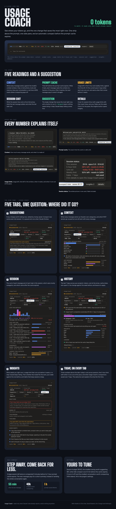

# Usage Coach

**See where your Claude Code tokens go, and the one change that saves the most right now.**

Usage Coach is a Claude Code mod. It adds a strip above the prompt and a side pane, both built only from figures Claude Code already reports. Watching it costs **zero tokens**: it never calls the model and never sends anything anywhere.



## Why

A long session gets expensive in ways that are hard to see:

- every message re-sends the whole conversation, so a 400k conversation costs more per message than a 40k one;
- the prompt cache keeps that resend cheap, but it expires after an hour, and the next message pays full price to send everything again;
- subagents, large tool outputs, unused MCP servers and a model bigger than the work quietly add cost.

Usage Coach makes each of those visible and tells you what to do about it: a fact with a number, then one step.

## The strip above the prompt

One line that fits the width of the prompt. When space runs short, the least important parts drop out first. Hover any part (desktop) for a card that reads the same way everywhere: the part and its state (✓ ALL GOOD, ◆ WATCH, ▲ ACT NOW), what it is, and what to do. The first time, a short welcome above the line explains it until you press **got it**.

| Part | What it shows |
| --- | --- |
| **Context** | Tokens in context against the model's context window, with a mark at 85%, where compacting pays off. |
| **Prompt cache** | Time left before the prompt cache expires: 1 hour normally, 5 minutes when Claude writes the short cache. Turns amber, then red. |
| **Usage limits · 5 hours / 7 days** | How much of each limit is left, against the time left in the window. At the current pace it also says when the limit runs out, and warns once when that comes before it resets. |
| **Session cost** | What this session has cost so far at API list prices, and what the last message added. |
| **Suggestion** | The single change that saves the most right now, such as compacting before the cache expires. A button runs it. Only savings of $1 or more over an hour of work are suggested; otherwise it says "✓ all good". When Claude fails the same step three times in a row, that comes first, with what it cost since the first failure. |
| **insights** | Opens the Insights tab. The number is how many insights this session has. |
| **details** | Hover for a status card: session time, model and cost, both usage limits with their reset times, and your Fable use over 7 days. Click it to open the side pane. |

## The side pane

Open it with `/usage-coach` or the **details** button. Every tab opens on three numbers: today's cost across sessions, the 5-hour limit (with when it runs out at this pace), and what Usage Coach's compactions saved over 7 days. It has five tabs.

- **Suggestions.** Every change worth making now, ranked by how much it saves, each with a one-line reason:
  - compact, or start a new session once the cache has expired on a large context;
  - turn off unused MCP servers;
  - use the Explore agent for searches;
  - ask for shorter tool outputs;
  - a notice when the session passes your budget.

  **Compact now** always works: while Claude is answering, the compaction is queued and runs as soon as the answer ends, and the strip shows "compaction queued" until then.
- **Context.** What every message sends, by Claude's own categories (as `/context` shows them): messages, system prompt, system tools, MCP tools, memory files, skills. A line marks 85% of the context window.
- **Session.** The cost of each message, then the cost of each task: every request of yours with its first words, how many messages and tool calls it took, and which was the most expensive. Plus which subagents ran and the largest tool outputs.
- **History.** The last 7 days across all your projects:
  - tokens and their cost at list prices;
  - how much came from the cache;
  - the split between your own conversations and subagents;
  - how many times the cache had expired and a large context was sent again;
  - which projects used the most, and a few lessons drawn from it;
  - the change against the 7 days before, and the project behind most of it;
  - what Usage Coach's compactions saved.

  It is read from Claude Code's own session files on your machine.
- **Insights.** What needs you right now, whether the model fits the work, and habits that keep sessions cheap:
  - a usage limit that runs out before it resets, and a step Claude keeps failing;
  - Fable or Opus on routine work points to a cheaper model, with what switching costs (a new model has no cache, so it sends the context once at full price);
  - Haiku on long multi-step work points to Sonnet;
  - subagents running on a top model, and Fable's share of your week;
  - a low cache share, returns after the cache expired, a large fixed context, a context near its limit;
  - your week against the one before.

  A model that does not fit the work is also said once per session in a notice. Insights are local rules over the same figures: they cost no tokens.

## Idle compact

If you leave a large session idle, Usage Coach compacts it 5 minutes before the 1-hour prompt cache expires. Coming back then costs a short summary instead of sending the whole conversation again. Small conversations are left alone, and so is a session on the 5-minute cache, which leaves no time to act.

## What it saved

Each compaction Usage Coach runs is counted once it pays off, and kept for 7 days on your machine:

- **idle compact:** the resend it avoided, minus the compaction, counted when you come back after the cache would have expired;
- **Compact now:** what every later request saves by carrying the smaller context, minus the compaction.

Nothing is estimated in advance: a compaction you never came back to saved nothing.

## Settings

Change these with `/plugin configure usage-coach@gabriel-mods`.

| Setting | Default | What it does |
| --- | --- | --- |
| Session budget | $100 | One notice when a session passes this amount in US dollars. 0 turns it off. |
| Smallest saving worth suggesting | $1 | Suggestions that save less over an hour of work are not shown. |
| Idle compact: minutes before the cache expires | 5 | When idle compact runs. 0 turns it off. |
| Smallest conversation worth compacting | 40,000 tokens | Below this, idle compact does nothing. |
| Cost line after each answer | off | A dim line under each answer with its figures. The Session tab already has them. |

## What it reads, runs and sends

Usage Coach sends nothing anywhere. It makes no network requests and never calls the model on its own. Everything below stays on your machine.

**What it reads**

- Session figures Claude Code reports (`session.usage`, `session.measure`): context size, cost at list prices, usage limits, the prompt cache.
- The token counts of each request (`turn.step`): input, output and cache figures only, never the text.
- Tool calls as they finish (`tool.call`): the tool name, its command or file path (for labels), whether it failed, and the size of its output. It never blocks or changes a call.
- The first 60 characters of each request you type (`turn.start`), kept in the session's local state to label the cost per task. They are not logged, saved to disk or shown in notices.
- Compactions (`session.compact`): the token counts before and after, to update the strip and count what was saved. It never changes a compaction.
- For the History tab, your local Claude Code transcripts in `~/.claude/projects`: only token counts, model names, timestamps and project folder names.

**What it runs**

- `node scripts/week.mjs --days 7 --prev`, from the plugin's own folder, to sum the last 14 days of the transcripts above. It tries `/opt/homebrew/bin/node`, then `/usr/local/bin/node`, then `node` on your PATH. It runs when a session starts (at most once every 2 hours), when you open History or Insights, and when you press Reload history. The script only reads files and prints a summary for the pane; it sends nothing.

**Slash commands it runs**

- `/compact`, only when you click **compact** in the strip or **Compact now** in the pane. It queues if Claude is answering and runs when the answer ends.
- Idle compact: when a session with 40,000 tokens or more of conversation has been quiet, it compacts 5 minutes before the 1-hour prompt cache expires. Turn it off with the setting "Idle compact: minutes before the cache expires" set to 0.

Both compactions go through Claude Code itself, on your own account, like typing `/compact`.

**What it adds**

- The `/usage-coach` command, answered locally (it opens the pane and costs no tokens). Its `command.run` hook matches only `/usage-coach`; every other command passes through untouched.

## Install

In Claude Code:

```
/plugin marketplace add gabrieloy-star/usage-coach
/plugin install usage-coach@gabriel-mods
```

Then start a new session.

To remove it: `/plugin uninstall usage-coach@gabriel-mods`.

## Credits

Thanks to the people whose mods shaped the ideas here:
Chris Han ([context-window](https://github.com/chrishan17/claude-mod-context-window)),
David Roberts ([claude-idle-compact](https://github.com/davidar/claude-idle-compact)),
Eric Cologni ([token-weather-usage](https://github.com/augiefra/claude-mods))
and Anthropic (session-report).
